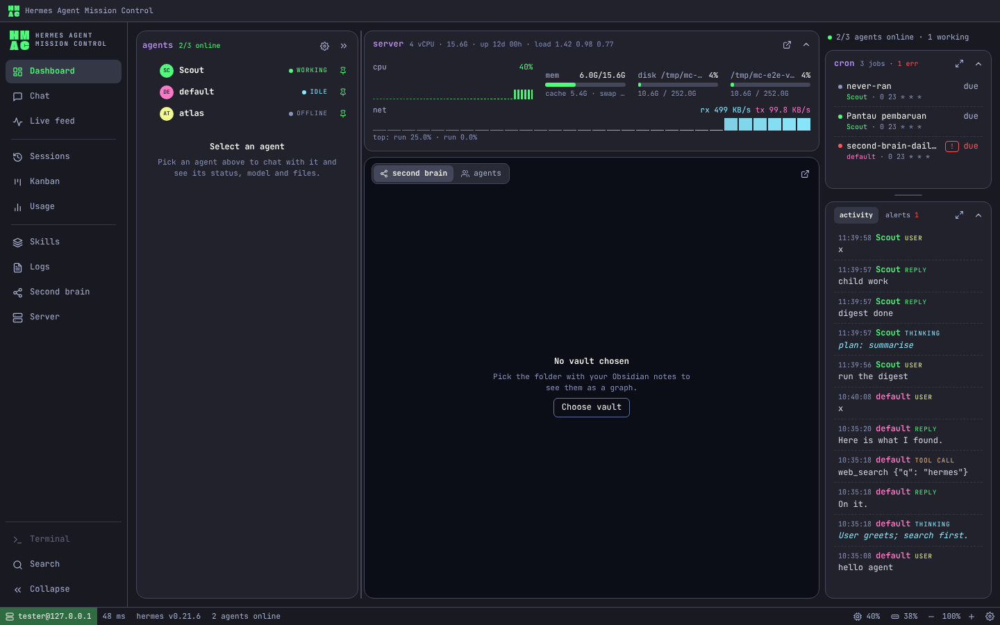
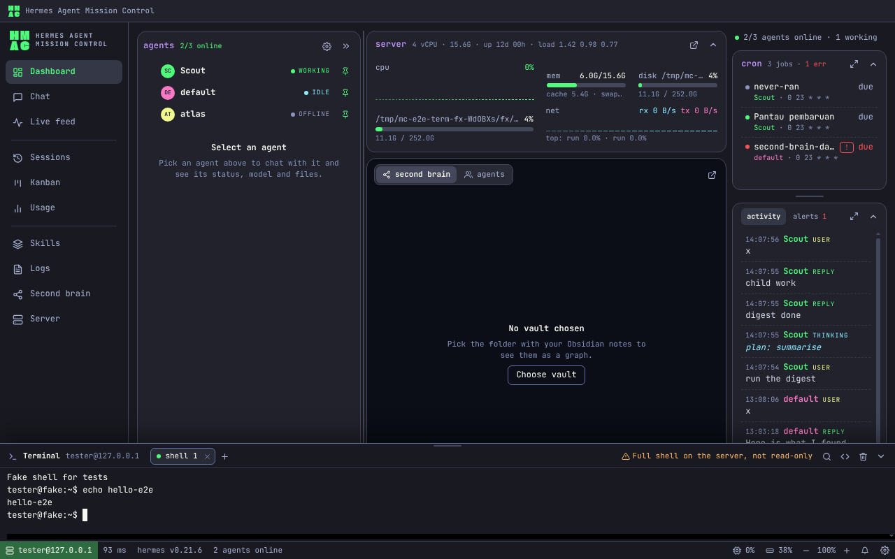
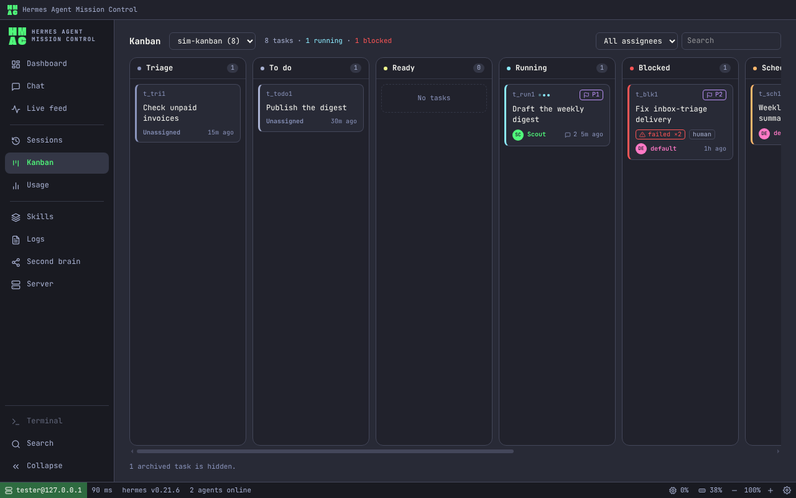

<p align="center"></p>

# Hermes Agent Mission Control

A desktop app (Windows, macOS, Linux) to watch and work with the [Nous Research Hermes Agent](https://github.com/NousResearch/hermes-agent) agents on your own Linux VPS, over SSH. One window shows every agent: what they say and think, their cron jobs, the server's health, their second brain, the tasks they hand to each other, and a chat with each of them.



## Download

Get the installer for your system from [Releases](https://github.com/fhdyt/hamc/releases):

| System | File |
|---|---|
| Windows 10/11 (x64) | `hermes-mission-control-<version>-win-x64.exe` |
| macOS (Apple silicon and Intel) | `hermes-mission-control-<version>-mac-universal.dmg` |
| Linux (x64) | `…-linux-x86_64.AppImage` or the `.deb` |

The installed app updates itself from new releases (Settings → General → *Check for updates automatically*). On Linux this works for the AppImage; a `.deb` is updated with your package manager.

The installers are not code-signed yet:

- **Windows:** SmartScreen says "Windows protected your PC". Choose **More info**, then **Run anyway**. The installer is per user and needs no administrator.
- **macOS:** right-click the app → **Open**, or run `xattr -cr "/Applications/Hermes Agent Mission Control.app"` once.
- **Linux:** `chmod +x *.AppImage && ./hermes-mission-control-*.AppImage`, or `sudo apt install ./hermes-mission-control-*.deb`.

## What you need

- A Linux server where Hermes Agent already runs, and an SSH user that can read its home (`~/.hermes` or `HERMES_HOME`).
- SSH password login for that user. The first connection shows the server's host key so you can check it before trusting it.

Nothing has to be installed on the server.

## What it does

- **Dashboard:** the agents with their status and a chat room for each, server CPU, memory, disk and network, the second brain graph, cron jobs and live activity.
- **Chat:** streamed replies, tool steps, approvals when Hermes asks before a risky action, file uploads, history. A reply sound and notifications tell you when an agent answers.
- **Live feed and Sessions:** every message, thought and tool call as it happens; search inside past sessions, transcripts, pin, rename and export.
- **Kanban:** the tasks agents hand to each other (read-only).
- **Usage:** daily cost per agent and per model, tool calls and failures, and a daily cost alert.
- **Skills:** each agent's skills, where they came from, pin, archive or restore, and install from the hub.
- **Logs:** agent, error, gateway and tool-call logs, gateway health and the approval policy.
- **Second brain:** your Obsidian vault on the server drawn as a graph, plus a timeline of each agent's MEMORY, USER and SOUL files.
- **Settings → Agents:** the model of each agent, SOUL/MEMORY/USER editors with a diff before saving, MCP servers, toolsets, fallback models, backups and new profiles.
- **Terminal:** a full SSH shell in a panel on every screen (Ctrl+`).
- **Command palette:** Ctrl+K to jump to any screen, agent, session or note.

| Terminal | Kanban |
|---|---|
|  |  |

## How it treats your server

The app is built to change nothing on the server by itself (the **Zero-Change** rule):

- No agents, scripts, services or open ports are added. A monitoring script is sent over the SSH connection and runs only while you are connected; nothing is written to disk.
- It never reads `.env`, `auth.json` or API key values, and never turns Hermes's approvals off or adds `--yolo`.
- Changes happen only when you press a button such as Save, Send, Restart or Upload, or type something in the terminal. Before a file is saved you see a diff, and changes go through the official `hermes` command line where one exists.
- Your SSH password is kept in the system keychain (Windows DPAPI, macOS Keychain, Linux Secret Service) only if you ask the app to remember it.

## Build from source

Requires Node.js 22 and Python 3.

```bash
npm install            # also rebuilds the native SQLite module for Electron
npm run dev            # run in development
npm run dev:fake       # a fake Hermes server over SSH on 127.0.0.1:2222 to try the app without a VPS
npm run dist:win       # Windows installer in dist/  (dist:mac and dist:linux on their own systems)
```

Tests: `npm run typecheck`, `npm test` (Vitest), `npm run test:py` (collector), `npm run test:e2e` (Playwright for Electron).

More: [release guide](docs/release.md), [manual test on a real VPS](docs/manual-vps-checklist.md), and the product spec in [docs/PRD-mission-control-hermes.md](docs/PRD-mission-control-hermes.md) (Indonesian).

## Status

Version 0.x. The real Hermes output formats were checked against the Hermes v0.21 source and one real install; anything that still looks wrong on your server is worth an issue, with your Hermes version (`hermes --version`).

Hermes Agent is a project of Nous Research. This app is an independent tool and is not affiliated with Nous Research.

## License

[MIT](LICENSE)
